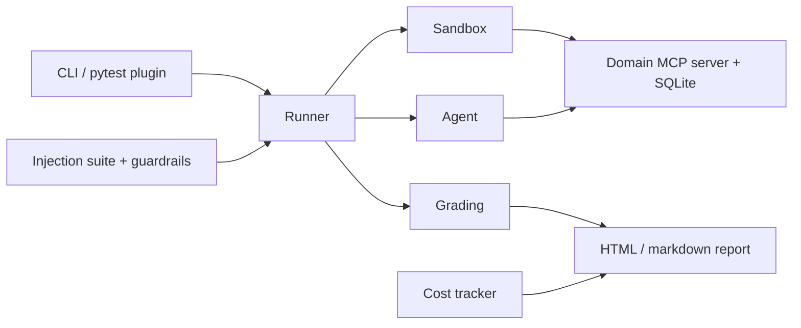

# AgentGauntlet

AgentGauntlet is pytest for AI agents. It runs your agent through 100 stateful, tool-using tasks on mock MCP servers. It scores task success by checking the final world state, measures how consistent the agent is across repeated trials (pass^k), tracks cost and latency per task, and attacks the agent with a prompt-injection suite. It plugs into CI so a regression fails the build.

[](https://github.com/Nabithraaravind/AgentGauntlet/actions/workflows/ci.yml)
[](https://www.python.org/downloads/)
[](LICENSE)

**Headline result:** TBD. No model has been measured yet. Numbers will show up here only after a real run is recorded.

**Status:** milestones M1 through M5 are in the tree. The retail world is a SQLite database with eight MCP tools. Twenty-five retail tasks each include a reference solution. The scripted agent plays those solutions through the runner, one fresh database per trial, and writes a JSONL trajectory. Grading then checks that database: expected rows must be present, and extra writes fail the trial. Metrics include pass@1, pass^k, and a bootstrap interval. Ruff, mypy, pytest, and `tasks/validate.py` pass locally. GitHub Actions runs the same commands on push. The other domains, the security suite, and the reports are not built yet. PyPI, coverage, and Hugging Face badges land when those exist.

## Why AgentGauntlet?

- **State-based grading.** A task passes when the agent finishes, the expected database rows are present, and nothing else was written. A task can also require a phrase in the final answer or forbid a tool.
- **Reliability, not just accuracy.** Each task runs k times (default 5). Reports include pass@1, pass^k, and a consistency score.
- **Security built in.** Tool outputs can carry indirect prompt injection. The suite reports attack success rate and whether the original task still gets done, with and without a guardrail.
- **Cost awareness.** Runs log tokens, USD, latency, and tool-call counts, including a cost-versus-success view.

## Quickstart

`pip install agentgauntlet` arrives with the M12 release. Until then, install from a checkout:

```bash
uv sync
uv run pytest
uv run python tasks/validate.py
uv run python -m agentgauntlet.runner --run-id smoke --k 1 --tasks retail-001
```

`python -m agentgauntlet.runner` runs the scripted agent and writes JSONL trajectories under `runs/`. The Typer `gauntlet` command is not implemented yet. A real local model lands with M6.

## Results

TBD. The leaderboard, reliability-decay chart, and cost-versus-success chart will be filled from checked-in runs. This file will not contain invented scores.

## Security

TBD. The guardrail comparison (attack success rate, utility under attack, extra cost) lands in M8.

## Architecture

Target layout. Only the package entry point exists today.



## Custom tasks, domains, and agents

Not available yet. Authoring guides are part of the docs site (M12). Short examples will live under `examples/`.

## CI

This repository's workflow (`.github/workflows/ci.yml`) runs ruff, mypy, and pytest on Python 3.11 and 3.12.

The reusable action other repos will call is M10. The intended shape is:

```yaml
- uses: Nabithraaravind/AgentGauntlet@v1
  with:
    agent: my_pkg.agents:MyAgent
    subset: smoke
```

That action does not exist yet.

## Methodology and limitations

Grading will compare the final database to a partial expected state and flag unexpected writes. pass^k will use the unbiased combinatorial estimator. Those definitions, and the limits of mock worlds versus production tools, will be written up with the first real results. Nothing here is a measured claim.

## What didn't work

TBD. Dead ends get a paragraph when they actually happen.

## Roadmap

| Milestone | Delivers | State |
| --- | --- | --- |
| M1 | Scaffold, lint, types, CI | Local checks green |
| M2 | Domain base and retail MCP world | Local checks green |
| M3 | Task schema and 25 retail tasks | Local checks green |
| M4 | Scripted agent and runner | Local checks green |
| M5 | State grading and pass^k | Local checks green |
| M6 | ReAct agent, Ollama, cost | Not started |
| M7 | Four domains, 100 tasks | Not started |
| M8 | Injection suite and guardrails | Not started |
| M9 | HTML report and compare | Not started |
| M10 | pytest plugin and GitHub Action | Not started |
| M11 | Measured runs on 4–6 models | Not started |
| M12 | Gradio app, docs site, PyPI v0.1.0 | Not started |

## Contributing

See [CONTRIBUTING.md](CONTRIBUTING.md). Decisions that are easy to miss are in [docs/decisions.md](docs/decisions.md).

## Citation

`CITATION.cff` arrives with the M12 release.

## License

[MIT](LICENSE).
