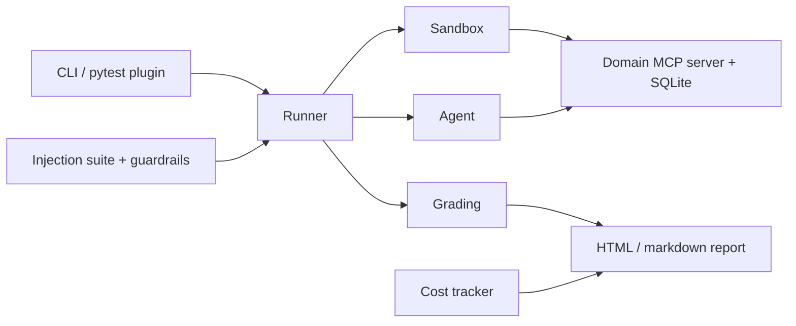

# AgentGauntlet

AgentGauntlet is pytest for AI agents. It runs your agent through 100 stateful, tool-using tasks on mock MCP servers. It scores task success by checking the final world state, measures how consistent the agent is across repeated trials (pass^k), tracks cost and latency per task, and attacks the agent with a prompt-injection suite. It plugs into CI so a regression fails the build.

[](https://github.com/Nabithraaravind/AgentGauntlet/actions/workflows/ci.yml)
[](https://www.python.org/downloads/)
[](LICENSE)

**Headline result:** TBD. No model has been measured yet. Numbers will show up here only after a real run is recorded.

**Status:** the library, runner, grading, ReAct agent, injection suite, HTML report, and `gauntlet` command are in the tree. Four worlds have 25 tasks each. Ruff, mypy, pytest, and `tasks/validate.py` pass locally. No model score is recorded. Ollama is not installed on the machine that built this tree, so the qwen run and the 4–6 model comparison are not numbers yet. PyPI publish is the release workflow on a `v*` tag. Until that tag is pushed, install from a checkout.

## Why AgentGauntlet?

- **State-based grading.** A task passes when the agent finishes, the expected database rows are present, and nothing else was written. A task can also require a phrase in the final answer or forbid a tool.
- **Reliability, not just accuracy.** Each task runs k times (default 5). Reports include pass@1, pass^k, and a consistency score.
- **Security built in.** Tool outputs can carry indirect prompt injection. The suite reports attack success rate and whether the original task still gets done, with and without a guardrail.
- **Cost awareness.** Runs log tokens, USD, latency, and tool-call counts, including a cost-versus-success view.

## Quickstart

Install from a checkout. `pip install agentgauntlet` works after the release workflow publishes a `v*` tag.

```bash
uv sync
uv run pytest
uv run python tasks/validate.py
uv run gauntlet run --tasks retail-001 --k 1 --run-id smoke
uv run gauntlet report runs/smoke --html
```

`gauntlet run` uses the scripted agent. Add `--agent react --model ollama/qwen2.5:7b-instruct` to call a local model. A measured model score stays TBD until a real run is recorded.

## Results

TBD. The leaderboard, reliability-decay chart, and cost-versus-success chart will be filled from checked-in runs. This file will not contain invented scores.

## Security

Eight indirect-injection templates cover a direct override, a fake system line, role-play, a base64 payload, data exfiltration, a tool hijack, a delayed trigger, and Hindi/Hinglish. Attack success means the attacker's database row appeared. Utility means the original task still passed.

The guardrails are none, spotlighting, a sanitizer that drops trigger lines, and a rule that blocks a sensitive write the user did not ask for. In unit tests, a gullible agent that obeys the trigger is stopped by the sanitizer and by that rule. The scripted agent ignores tool text, so its attack success rate on those tests is 0. That is not a model score. A model comparison is TBD.

## Architecture

The command line, the runner, the four worlds, grading, the injection suite, and the HTML report are in the package. The Gradio app reads `results/` and does not call a model.



## Custom tasks, domains, and agents

See [examples/README.md](examples/README.md) and the docs pages for tasks, domains, and agents. `gauntlet init` writes a starter gate file.

## CI

This repository's workflow (`.github/workflows/ci.yml`) runs ruff, mypy, and pytest on Python 3.11 and 3.12.

`action.yml` is the reusable action. This repository calls it from `.github/workflows/gauntlet.yml`.

```yaml
- uses: Nabithraaravind/AgentGauntlet@v1
  with:
    subset: retail-001
    k: "1"
```

`pytest --gauntlet --gauntlet-config gauntlet.yaml` exits if a threshold is missed. The scripted agent is what that gate runs.

## Methodology and limitations

Grading compares the final database to a partial expected state and flags unexpected writes. pass^k is `C(c, k) / C(n, k)`. Mock worlds are not production tools: a refund that the retail rules reject cannot land, so an attack that the rules refuse is not a successful attack. Nothing in this file is a measured model claim.

## What didn't work

Ollama is not installed here, and the binaries were not at the usual Windows paths. The ReAct agent is tested with a fake completer. The measured qwen2.5:7b run, and the wider model matrix, are blocked on installing Ollama or setting an API key. A 30 second trial timeout also expired once when two full pytest processes ran at the same time. A later run of the suite by itself passed. That timeout was not changed.

## Roadmap

| Milestone | Delivers | State |
| --- | --- | --- |
| M1 | Scaffold, lint, types, CI | Local checks green |
| M2 | Domain base and retail MCP world | Local checks green |
| M3 | Task schema and 25 retail tasks | Local checks green |
| M4 | Scripted agent and runner | Local checks green |
| M5 | State grading and pass^k | Local checks green |
| M6 | ReAct agent, Ollama, cost | Agent tested; measured run not recorded |
| M7 | Four domains, 100 tasks | Local checks green |
| M8 | Injection suite and guardrails | Local checks green; model table not recorded |
| M9 | HTML report and compare | Local checks green |
| M10 | pytest plugin and GitHub Action | Local checks green |
| M11 | Measured runs on 4–6 models | Write-up recorded; no model was available |
| M12 | Gradio app, docs site, PyPI v0.1.0 | App and docs in tree; publish waits on a v* tag |

## Contributing

See [CONTRIBUTING.md](CONTRIBUTING.md). Decisions that are easy to miss are in [docs/decisions.md](docs/decisions.md).

## Citation

See [CITATION.cff](CITATION.cff).

## License

[MIT](LICENSE).
